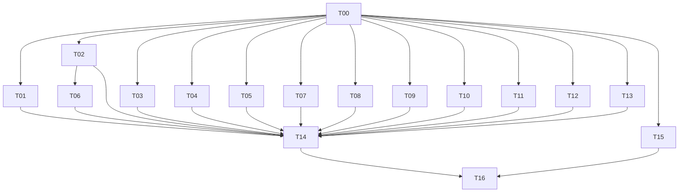

# 並行調度、所有權與衝突規則

## 1. 開工閘門

G0=T00 的真實 contracts／基礎設定已寫入且最小型別／建置通過。G0前只有主 Agent 改程式根設定；素材代理可先讀10、撰prompt並生成風格參考，不修改程式或自行決定manifest。

G0後可啟動 T01/T02/T03/T04/T05/T08/T09/T10/T11/T12/T13/T15。T06 在 T02公開stepMovement可用後開始AI接入，先前可整理首領行為。T07在G0後可寫 renderer，正式視覺需T10–T12資產；正式地圖需T05。

T14分a/b/c：a在G0後建app接線，b隨可用模組接入，c等必要包及T15-a正式adapter後完成主線。T15-a為工具／SDK／adapter／Manifest（T15-01..07、09..10），G0後可做；T15-b為實際封面／候選pack驗證（08、11..12），等T14-c。這不是循環依賴。T16等待T14-c＋T15-b，不提前假填通過。

箭頭表示完成依賴，不要求等父包所有非必要美化才開始下游設計。G0是程式開工共同閘門；T07與T15的最終驗收都需要T14成品，不能把可提早開工當成可提早完成候選。

## 2. 四槽環境的可直接執行排程

主 Agent 佔一槽，三位子代理採滾動排程；下面是確定的初始隊列，不是必須等待整波齊完才繼續。

| 通道 | 按序承接 | 配合主 Agent |
| --- | --- | --- |
| A 規則／數據 | T01 → T04 → T05 → T09 | 主 Agent 提早拿到內容及交易介面 |
| B 世界／戰鬥 | T02 → T03 → T06 → T07 | T02完成即可解鎖AI；T03先不用真實怪物即可測命中 |
| C 素材／介面 | T10 → T11 → T12 → T08 → T13 | 每包可先交參考／第一套正式資產，renderer不需等全包 |
| 主 Agent | T00 → T14-a/b，空檔做 T15 → T14-c → T16 | 主 Agent保留整合控制權 |

若可用槽位更多，T05/T08/T09/T11/T12/T13/T15皆可在G0後拆給獨立代理；不得同時派同一所有權。若素材較慢而A/B閒置，先讓該代理結束既有包、報告並釋放所有權，再接T11/T12/T13，主 Agent可以滾動調度。不為固定隊列讓已就緒工作空等。

大包的微步驟只供追蹤，**不能**因T10有多個角色就同時派兩人寫同一actors manifest。若確需再拆，主 Agent先按檔名分成互斥子目錄及manifest，更新本表並廣播。

## 3. 唯一寫入者

package.json、lockfile、tsconfig、vite設定、index.html、src/main.ts、src/contracts/**、src/app/**、tests/integration/**、plan/status.md，全部由主 Agent 或其明確指定的唯一整合代理持有。T00完成後其他代理若需新增套件／script，回報需求，不直接改。

每包只修改 tasks索引允許的路徑及自己的 plan/reports/Txx.md。禁止 git reset/clean、還原他人變更、批次格式化全專案、刪整個dist或共用資產。共用工作目錄由主 Agent統一安裝及建置；子代理不啟第二個安裝／dev server。若環境選用隔離工作樹，主 Agent負責逐包整合，不假定其他樹的未提交檔案即時可見。

測試檔按包分配，局部測試可並行；typecheck/build/check:content聚合由主 Agent排程。沒有相關代碼變更不重跑通過檢查。

## 4. 接口交接與變更

子代理先讀實際contracts，與07不符時報主 Agent，由其決定更新程式或文件。禁止用any、本地重複型別、全局window物件或額外單例繞過。需要另一包提供功能，發送「需要的signature＋使用情境＋目前阻塞步驟」，不直接改該包。

每包交付到REVIEW：列檔案、公開匯出、實際檢查、未完成、接線例子與禁止事項是否遵守。主 Agent確認介面及最小接線後才標DONE；素材不能僅有prompt、程式不能僅有stub。

## 5. 圖片與瀏覽器共用資源

ImageGen按T10/T11/T12資產ID排工作單，不使用模糊的「最近一張」作跨代理參考。各自本地參考先view_image，指定referenced_image_paths。若工具共用對話／受限，主 Agent單一圖片佇列，子代理交明確prompt並繼續metadata。一次失敗只重做該資產，不整包反覆生成。

只有T16／主 Agent操作共用驗收瀏覽器，避免不同代理切頁互相干擾；UI/樣式包不為可逆布局自行開瀏覽器。若必要，主 Agent分派一個明確功能的檢查窗口，收回後再做整合。

## 6. 卡住時的處理

網路／工具／測試環境問題先判斷與本包是否相關。無關則記未驗證，完成其他步驟，不能耗整輪重建環境。規格未完整取得時不做依賴缺失規格的接入；素材生成失敗標未完成，不偷偷用占位宣稱正式完成。外部發布缺授權只阻塞發布，不阻塞本機候選。

## 7. 2026-10-18 本輪唯一整合者

主 Agent 僅負責派工與協調，未直接寫程式；經明確委派，主工作目錄的單一整合代理負責 T00 收尾、T14 組裝及後續 T16 唯一瀏覽器驗收。其寫入範圍為根設定、`src/contracts/**`、`src/app/**`、`src/main.ts`、`tests/integration/**`、`tools/check-content.ts`、全局狀態與交接文件；不改 `src/render/**` 或 T15 平台打包路徑。

T07 renderer 與 T15 package 分別在獨立 worktree 工作，只由整合代理核對並合併；共用 main index 不並行寫入。整合代理先完成 T00-09 與自身 T14 準備並提交，再承接 T07/T15 合併。T16 只在 T07 接合及可執行候選就緒後進行，使用單一共用瀏覽器／server，截取真實遊戲畫面供 T15 封面，不以測試資料注入或跳級代表完整主線時長。
