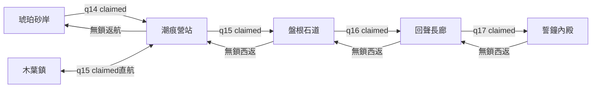

# 下一章內容設計：遠古遺跡・失聲的誓鐘

日期：2026-10-25（香港時間）。狀態：**設計完成；包 A 程式與素材已實作，實際遊玩未驗證；B／C／D 尚未完成**。原企劃由主規劃獨立完成；A 實作由主代理指揮全新 GPT-6 Luna Max 分批完成，詳見 [A 整合交接](reports/ruins-a-handoff.md)。

本稿為下一內容包的設計來源，不重寫q01–q14既有事實。企劃階段保留beta.11且不修改程式；後續本輪A另立beta.12，獨立建置於artifacts/ruins-a/dist，未提交或發布。以下完整章節設計仍保留，尚未實作部分不視為已開放。

下一步 B 的接線、素材派工、最小驗收及 A 之後的存檔格式決策，見 [13 回聲探索實作計畫](13-ruins-echo-exploration.md)。該計畫尚未實作；其中讀1／2／3、寫3的決策取代本稿第8節供全章沿用格式2的早期建議，避免現有A候選誤讀B新進度。

## 1. 方向與規模

採用世界圖已預留的「遠古遺跡」。日井恢復平靜後，南方舊航標傳回錯拍鐘聲：遺跡的傳訊機關失去彼此的回聲，無法辨認旅人。玩家要調查並修復它，而非單純摧毀另一座祭壇。

| 項目 | 設計決策 |
| --- | --- |
| 進入條件 | q14已手動領獎；不要求仍持有／裝備日井誓刃 |
| 內容 | 4張地圖、3種普通怪、1名雙階段首領 |
| 任務 | q15–q19五個主線＋q20選做支線 |
| 成長 | 維持Lv30、一轉與原技能；小幅提升防具，保留日井誓刃地位 |
| 新互動 | 兩塊固定石碑的調律；不做限時、自由輸入音階或音高辨識 |
| 時長目標 | 主線12–20分鐘，含選做探索18–25分鐘，均待實測 |
| 結局 | 誓鐘恢復傳訊，回木葉鎮向教官回報 |

本章不增加二轉、等級上限、元素抗性、裝備強化、飛行AI、游泳或致死落穴。新鮮感由路線、站位與出招節拍提供。

## 2. 故事與角色

### 三段故事

1. **異常回聲。** 琉砂在q14領獎後提出新的委託，請玩家去找潮痕營站的研究者。新增對話，不補稱日井守衛曾說話或授予其他道具。
2. **不完整的碑。** 碑文記載各地守望者曾透過誓鐘互報平安。古礦、冰潮、日井紋樣相互對應，是本章新揭露的歷史；不把先前敵人改寫成被同一惡人操控。兩碑合起來的意思是「守護的是歸途，不是封鎖所有來路」。
3. **解除錯誤守望。** 司鐘者仍遵守拒絕陌生訊號的命令。戰勝後機關停止攻擊，三段回聲重新接通。教官認可玩家開始理解守望者的責任。

結尾留「還有一段回聲未抵達」的伏筆，不顯示下一區為可玩節點、不承諾開放日期。

| NPC ID／名字 | 地點／角色 | 台詞方向與功能 |
| --- | --- | --- |
| sands-guide／琉砂〔既有〕 | 琥珀砂岸 | 「日井安靜了，南方的鐘卻還在錯拍。去找芷衡，她更懂那些刻痕。」q15發起 |
| ruins-archivist／芷衡 | 潮痕營站／keeper | 「別急著替每道裂痕找敵人。先看看，它原本想保護什麼。」研究、主線交接 |
| ruins-pathfinder／行舟 | 長廊西側安全區／scout | 「兩塊碑都在高處。先找梯子，別站在巡鈴獸正前方讀字。」前線任務 |
| ruins-medic／青禾 | 潮痕營站／healer | 「歇好了再走。鐘聲可以等，你的傷不能。」沿既有免費恢復HP／MP |
| mentor／岩嶺教官〔既有〕 | 木葉鎮 | 「能握緊劍，也要知道何時讓它放下。」q19收尾 |

石碑採專用靜態keeper互動對象。補給沿木葉鎮商人；現有交易對merchant ID有特判，本章不擴新商人系統。

## 3. 地圖與交通

座標為世界像素。各圖高720、主地面腳底y600、正常視口960×540；平台碰撞先定，背景不烘焙可走地形。

q15的目標才是抵達營站，所以入口檢查q14，不能要求先claim q15。直航為實際portal，不憑空增加世界圖任意傳送功能；營站往鎮無鎖，鎮往營站需q15 claimed。

| ID／地圖 | 寬／屬性 | 結構與辨識地標 |
| --- | --- | --- |
| ruins-tide-camp／潮痕營站 | 960／safe／無怪 | 左返航、中央芷衡、右側青禾與前進門。潮濕石階、帆布棚、遠方斷鐘塔 |
| ruins-root-causeway／盤根石道 | 2400／普通 | 地面通東西門，上層盤根橋、斷柱與梯子構成迴路。3個苔陶蟲點約x700／1250／1850；兩端至少300px無威脅區 |
| ruins-echo-gallery／回聲長廊 | 2600／普通 | 行舟在西側x300；兩碑約(900,420)、(2000,360)。上層讀碑、下層交戰，梯路與下跳串接。2木偶＋2巡鈴獸 |
| ruins-bell-sanctum／誓鐘內殿 | 1800／boss | 西門x100、入場x160，主戰場x700–1560。平坦地面、中央懸鐘、後方殘缺石環；不以平台遮預警 |

### 放置限制

- 保留琥珀砂岸東西門、琉砂與沙蠍。新增南航平台建議x120–360、y480、梯x160接地；新門約(160,480)，回程spawn約(280,480)。NPC優先於portal，兩者互動範圍不可重疊。
- 營站芷衡約x420、青禾x660，兩側門約x100／860。新增鎮內直航門實作時按現有NPC位置選點，不與商人／教官重疊。
- MapBlueprint目前普通怪固定y600出生，本章不依賴平台／空中出生。角色單跳理論高度約84.5px，必要高台均接梯，不用精準跳躍卡主線。
- 長廊木偶roam約x720–850、1510–1630；巡鈴獸約x1100–1240、1940–2070。最東攻擊端點不超過x2330，右門留安全帶。兩碑平台要高於地面攻擊，避免讀碑時受傷。
- boss roamLeft≥700，最長reach≤360，使x≤240入場／退場帶在判定外；還須核對既有邊界外追擊邏輯。西門永遠可退，不用戰鬥鎖門。
- 死亡沿既有免費回城，不新增復活點；直航避免死亡後重走霜雪／沙海。重進內殿重置本場boss，不抹任務進度。

世界圖增加ruins scope，沿預留遠古遺跡位置(69,86)；區域四節點建議(16,72)、(40,55)、(67,39)、(86,22)。真實MapDef接入後才算可玩／探索數並移除planned marker。

## 4. 普通怪與掉落

皆Lv30，以下是待實測的首輪起點；不改舊怪。移速px/s，出招時間ms。所有怪respawn9000，exp0（入口已Lv30）。

| ID／名字 | 外觀／角色 | HP／ATK／DEF／速度 | 攻擊 |
| --- | --- | --- | --- |
| ruins-moss-carapace／苔陶蟲 | 破陶背殼、細根觸鬚、低矮緩行；殼有鐘紋 | 1100／48／20／42 | 近身reach60×高70，倍率1；550預警／80 active／770 recovery，起手間隔≥1400 |
| ruins-string-puppet／斷弦木偶 | 瘦長木身、斷銅線、單側長臂；逼玩家退後再回擊 | 1280／54／23／56 | 前拍160×100，倍率1.1；1000／100／900，起手間隔≥2200 |
| ruins-bell-prowler／巡鈴石獸 | 低身四足、背負破鈴；教跳低掃 | 1360／56／24／48 | 原地低掃260×30，倍率1；1100／100／900，起手間隔≥2400 |

長前搖起手鎖向，最後一幀不轉向。低掃用現有矩形判傷，畫完整區域與方向，不做會移動的假彈體。無無敵殼、背擊、減速、沉默等新狀態。

沿既有地面移動／attack state；苔陶蟲也須有對應550ms起手的獨立技能（ruins-carapace-bite），木偶／石獸新增ruins-puppet-slap／ruins-prowler-sweep及選招、預警接線，不是只填MonsterDef。

| 掉落材料ID | 名稱／售價 | 掉落與用途 |
| --- | --- | --- |
| moss-ceramic | 苔紋陶片／45 | 苔陶蟲必掉1；金幣90；僅探索收益 |
| broken-copper-thread | 斷裂銅弦／50 | 木偶必掉1；金幣95；僅探索收益 |
| muted-bell-fragment | 失聲鈴片／55 | 石獸必掉1；金幣100；q20交付3枚，出售後可再取得 |

## 5. 首領：失序司鐘者

ID ruins-bell-keeper。四足機關懸著破鐘，青銅支架與白石面具構成輪廓，不再做直立巨拳砂岩像。顯示192×192、碰撞約88×76；Lv30、HP8000、ATK60、DEF28、速度38、exp0、金幣0、無隨機裝備。

| 招式ID／名稱 | 範圍與時序 | 解法與辨識 |
| --- | --- | --- |
| ruins-bell-slam／垂鐘重擊 | 前方180×120、倍率1.25；900預警→100 active→1000 recovery | 鐘錘抬起、完整矩形；退離近身區，落錘後回擊 |
| ruins-bell-sweep／低鳴橫掃 | 前方360×30、倍率1.05；1200預警→100 active→1000 recovery | 鐘口朝地、低位線紋；跳躍或離開範圍，不是移動彈體 |

- HP>50%：重擊→橫掃循環，每招recovery後加600ms空檔。
- HP≤50%：等本招完整結束，再做一次1200ms無傷轉場；從橫掃→重擊→橫掃循環起點開始。額外空檔縮到300ms，預警／recovery不縮，不疊招。
- 每個attack ID只命中一次；死亡、切圖、重試或boss倒下時取消剩餘攻擊／音效。兩招首輪已教，不加突襲秒殺招、不召小怪。
- 靜音仍靠姿勢與預警辨識。勝利採現有結果畫面；重試只重置戰鬥、不重發任務獎勵。結果返回營站，步行西門回長廊；只加新boss目的地，保留Guardian流程與兩個flags。

紙上參照：Lv30、STR132、DEX29（145 AP分為120 STR／25 DEX）、日井誓刃ATK58，按現有公式總ATK350。對DEF28首領，無暴擊普通攻擊約319–352、滿級重斬約658–727；HP8000約12–13次重斬命中。不要再用長無敵拖時間。

上述非測試結果。目標熟悉後45–80秒、首次觀察60–120秒；實測須包含冰潮長鋒與未最佳化配點。裝備日井誓刃不是門檻，不為未配點角色暗補能力。

## 6. 任務與獎勵

全為手動接取／claim；ready不開門。獎勵exp0、不改職業／等級，不消耗武器。q20不進主線prerequisites或門鎖。

| 任務 | 前置；發起→交付 | 目標 | 一次獎勵／解鎖 |
| --- | --- | --- | --- |
| q15 南方的錯拍 | q14；琉砂→芷衡 | reach營站 | 大紅6＋大藍3；開石道與鎮內直航 |
| q16 盤根之下 | q15；芷衡→芷衡 | 接取後殺苔陶蟲3 | 金幣700；開長廊 |
| q17 兩段回聲 | q16；行舟→行舟 | 調律西碑1／東碑1；接取後殺木偶2 | 金幣800＋大紅4＋大藍2；開內殿 |
| q18 讓誓鐘歇息 | q17；行舟→芷衡 | 接取後殺司鐘者1 | 守誓旅冠1＋金幣1600；主衝突結束 |
| q19 帶回歸途 | q18；芷衡→岩嶺教官 | reach木葉鎮 | 金幣300；對話收尾，不鎖下一區 |
| q20 留給旅人的鈴聲〔支線〕 | q16；行舟→行舟 | 接取後殺巡鈴石獸3，持有並交付鈴片3 | 金幣600＋大紅4；不給主線專用能力 |

途中必要營站回訪只有q16一趟。q17就地交付；q18結果回營站，q19走直航／既有回城。q20可與q17並接，3隻為2生成點加一次重生。

reach沿既有「已訪即滿足」語義：q15可先進營站再接；q19可能接取即ready，仍須赴教官手動交付。文案用回報，不說必須重新穿指定門，不重寫所有舊reach。

旅冠ID oathfarer-circlet：hat、Lv30、DEF10、HP+20、ATK0、buyPrice0、sellPrice600、stackLimit1。相對鐵盔DEF8／HP0小幅提升；日井誓刃ATK58不變。需要128×128 icon及帽子overlay、沿既有頭部anchor；不加抗性／套裝。

### 調律互動契約

1. 對象ruins-stele-west／ruins-stele-east為固定keeper，靜態專圖。走近Space開碑文，再按「調律石碑」。
2. q17 active才計入；之前可讀但不存隱藏進度。新增inspect目標／事件／確認命令，gameplay重驗地圖、距離、對象ID、任務狀態，不只信UI。
3. 即時確認、無讀條、無資源消耗；各碑最多1、次序不限、重複不獎勵。
4. 存q17 counters；發光由counter或claimed推導，不增全域flags。離圖／死亡／重載保留，成功後才呈現該段歷史。
5. 面板不凍結戰鬥，碑必放安全高台；不以看見背景圖取代真互動。
6. UI、quest邏輯、content validator、save counter驗證及claimed完整性都加inspect支援（目前多處只收kill／reach）。NPC面板要同時列q17／q20，不讓摘要只找到第一件而隱藏支線。

## 7. 素材與音訊

色調從沙金轉潮濕白石、青綠盤根、氧化銅；石碑常亮不模仿危險閃爍。四地景逐步由海岸殘塔轉閉合鐘室，不能只換色。

| 包 | 交付範圍 |
| --- | --- |
| 區域圖 | 960×540一張，文字與節點由UI繪製 |
| 環境 | 四主題各sky960×540／far1440×540／mid1920×540，共12張。far／mid真RGBA，mid y≥180全透明；不烘焙平台／操作字 |
| 物件 | 石碑共用底圖＋狀態小光效、南航路標、破鐘、盤根裝飾 |
| 演員 | 3普通怪＋1boss＋3新NPC；碑用靜態專圖 |
| 圖示 | 3材料＋旅冠，128×128RGBA、runtime32；旅冠另交overlay |
| 音樂 | theme-ruins base＋combat、boss-ruins base＋phase2；首誓動機的鐘音／木管變奏，沿離線工具與Ogg／M4A回退 |
| 音效 | 調律短音、誓鐘復原；不靠聽辨音高通關 |

沿實際loader動畫契約：普通怪96×96、boss192×192、pivot(.5,1)；6欄×5列，idle2×200ms、walk6×120ms、attack4格依招式時間、hurt2×100ms、dead4×100ms，未用格補最後有效幀。先審角色profile／動作再全套生成，不因失敗逐隻放寬規格。

背景沿sky0／far0.2／mid0.5與真來源尺寸，新區不套Sunwell獨有Y1.6。現有beta.11 r2動態視差／抖動未完成瀏覽器驗收，不順帶宣稱通過。

新增runtime壓縮增量預算≤24MiB，先估檔案清單；只載當前音樂組。原稿／prompt／來源鏈留art-source、不入dist；對話只載必要縮圖。成品仍需固定tools完整驗證。

## 8. 存檔與工程依賴

真實程式基線：QuestObjectiveType只有reach／kill／collect／equip；MapBlueprint普通怪固定地面；AtlasScope僅world／frost／sand；新互動、ruins分區與boss目的地均需接線。新增ID目前會被舊persistence validator拒絕，不能把同格式號當可回退證明。

本章保留SaveData頂層、角色、裝備與Guardian flags；新版讀舊檔時缺q15–q20合法，不要求重開。正式內容交付建議把遺跡進度標為format2，新讀取器讀1／2、寫2；format1先按當前catalog驗證、保留原資料遷移。這是實作建議，本次不改格式或manifest。

平台會檢查目前上架版本能否讀寫入結果。若舊公開版只讀1，需先部署讀1／2、寫1且實際理解新IDs的橋接版，再讓內容版寫2；不能只改manifest虛稱可讀。沒有橋接時，新版預覽只驗模擬保存，不稱正式寫2可用。發布仍須另行授權。

不認識遺跡的舊版應被阻擋讀format2，不能刪任務或偷偷改位置來假裝相容。localStorage不受平台保護，不支援格式必須保留資料並提示，不能新角色覆寫。若先沿format1試作，只用隔離fixture，明列「舊版無法讀新增進度」，不得作已解決回退相容性的正式交付。

## 9. 下一步實作順序

| 包 | 範圍 | 最小完成條件 |
| --- | --- | --- |
| A 入口與第一遭遇 | 營站／石道、芷衡／青禾、苔陶蟲、q15／q16、直航／區域圖 | 正式MapDef路線覆蓋q14鎖門→q15到站claim→殺3→q16 claim→自由返回；舊檔缺新任務可讀。完成即停 |
| B 回聲探索 | 長廊、行舟、木偶／石獸、兩碑inspect、q17／q20 | 聚焦互動距離／重複／次序、重載保留、售材後重取；支線不鎖主線 |
| C 章節收尾 | boss、q18／q19、旅冠、音樂／結果返回 | 選招／切階段／一次命中／取消攻擊；接取→擊敗→回報→獎勵一次→教官收尾；舊flags不變 |
| D 候選交付 | 存檔方案、素材metadata、必要建置／封包 | 最終變動的typecheck／content check／聚焦測試；穩定後build及pinned pack/validate各一次；一次有範圍iframe驗收 |

存檔方案在A開始前定下並排入依賴，不等D才處理counter載入。A–C可用隔離fixture，不代替帳號／遷移驗收。不跑全回歸、不為文案加測試、不反覆截所有地圖。後續執行依使用者當時指示，本次不實作、不派子代理。

## 10. 來源與企劃階段驗收

盤點來源：src/content/world的quests／maps／npcs／dialogues、src/content/rules的monsters／items／skills／progression、contracts/definitions、domain的quests／actors／combat／progression、app/gameplay、persistence/index與validate、ui/world-map-model；參考plan的01／06／10與既有擴充報告。實際catalog優先於早期七圖企劃和過時狀態文字。

2026-10-25完整網路讀取Playroom main模板與七指定文件：game-development、command-contracts、game.schema.json、game-release.yml、starter/playroom-sdk.js、sdk-versioning、save-compatibility。網頁工具快取仍含舊上限，另以no-cache讀main全文核對，以後者為準。適用：舊進度保留、存檔兼容明列、素材相對URL／iframe、無發布。

企劃階段只驗設計依賴、交通與手動領獎門鎖、文件差異和索引，當時未生成素材、啟動瀏覽器、跑遊戲測試或build。後續A實作與beta.12檢查以整合交接為準；新章時長／難度／完整流程仍未驗證，beta.11產物未覆寫。

